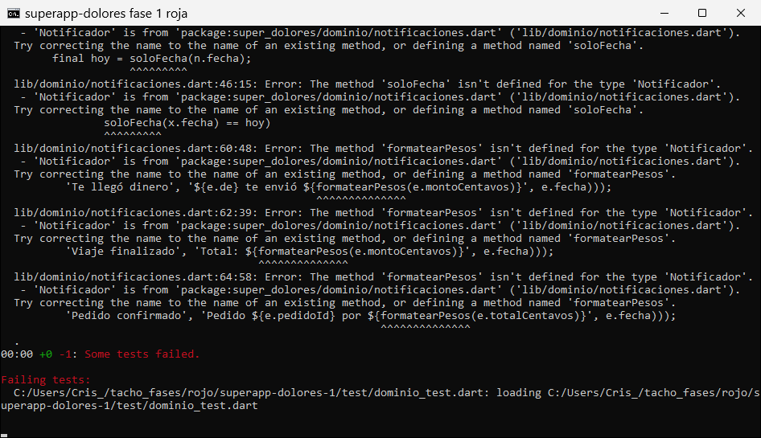
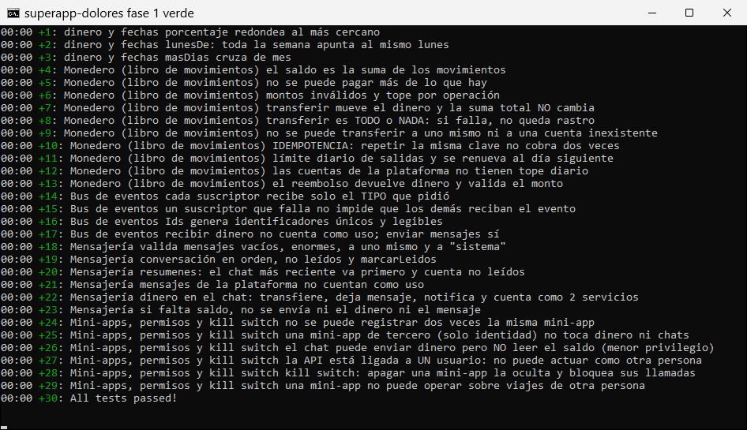
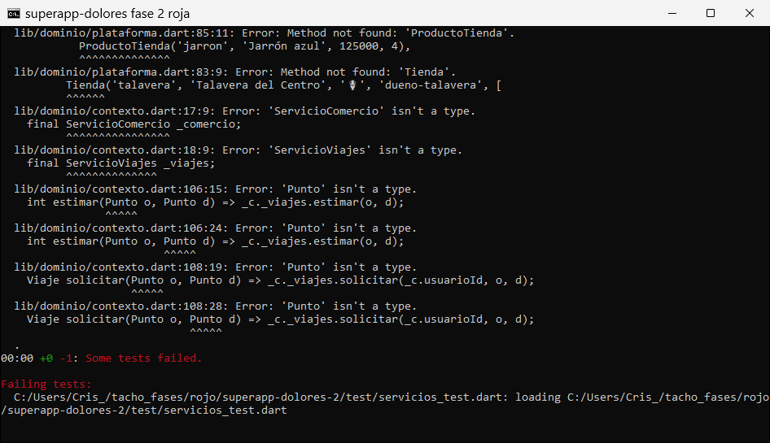
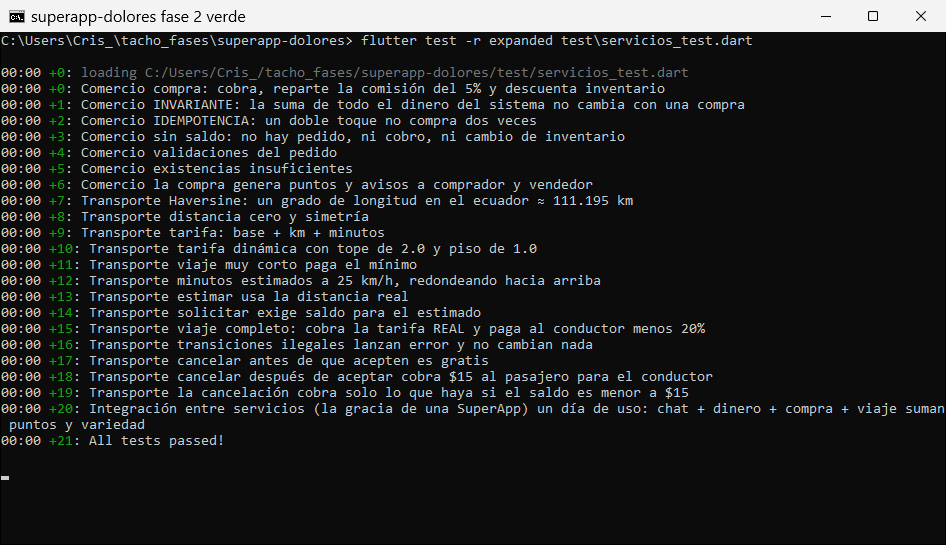
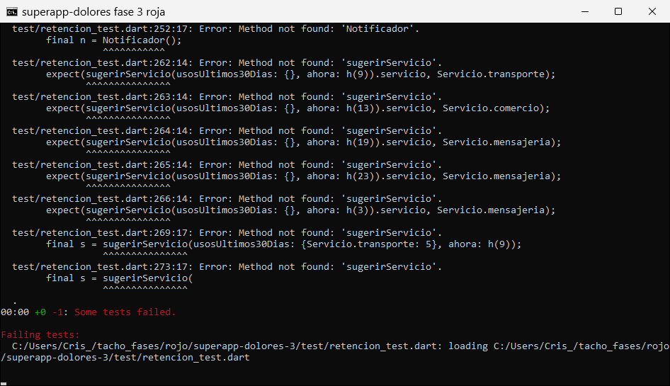
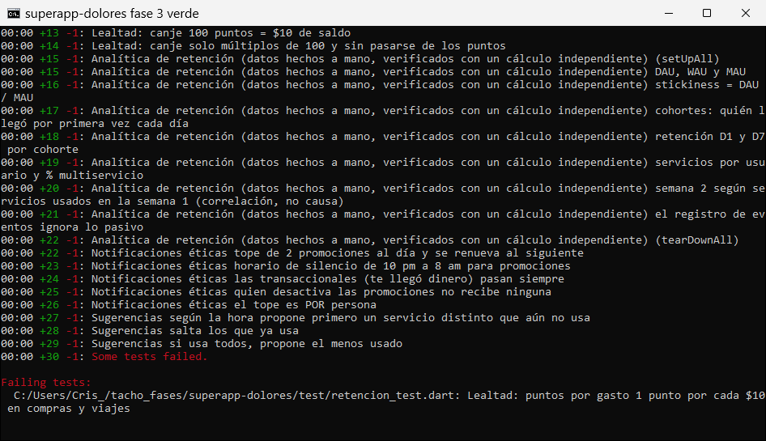
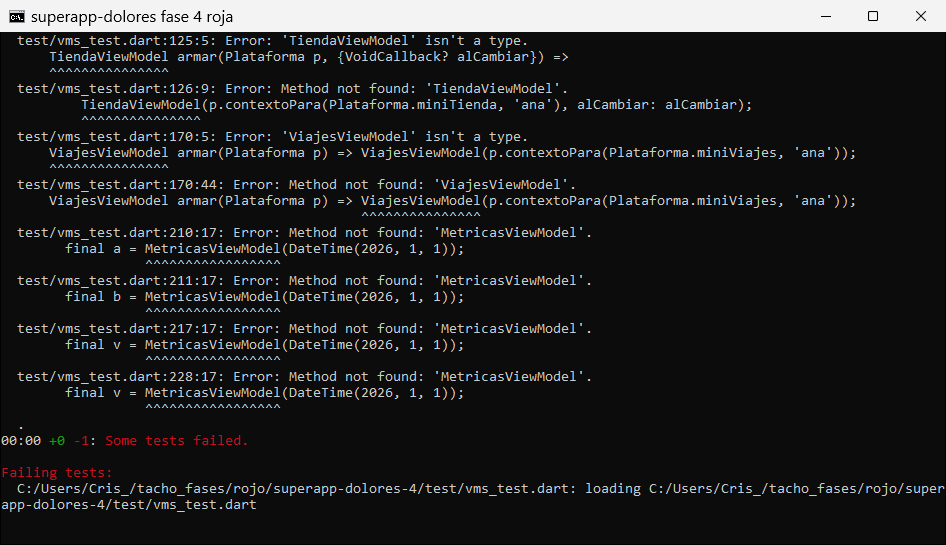
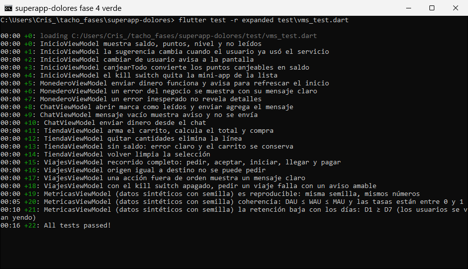
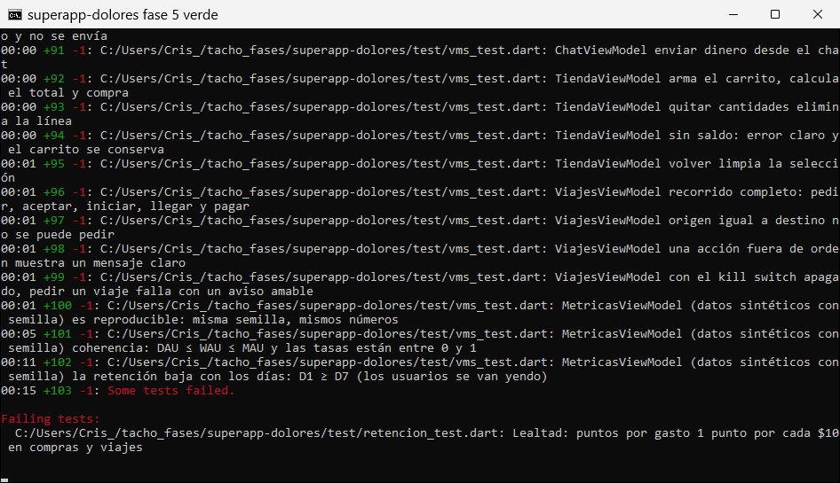

# 🏛️ Super Dolores: una SuperApp con TDD

**Actividad 13. Desarrolla una SuperApp** · Desarrollo de Aplicaciones Móviles · UTNG
Prof. Anastacio Rodríguez García

Mensajería, pagos, comercio y transporte en **una sola app**, con mini-apps, permisos por capacidad (menor privilegio), bus de eventos, *kill switch*, lealtad y métricas de retención (DAU, WAU, MAU, stickiness y cohortes). Todo el dominio es Dart puro y se construyó con el ciclo **🔴 Rojo → 🟢 Verde → 🔵 Refactor**.

> ⚠️ Es una simulación didáctica: no mueve dinero real ni transporta personas.

## Cómo ejecutar

```bash
flutter pub get
flutter test -r expanded   # todas las pruebas
flutter run                # la app en el emulador
```

## Arquitectura

```
lib/
  dominio/       dinero · excepciones · eventos · monedero · mensajeria · comercio · transporte
                 mini_app · contexto · plataforma · lealtad · analitica · notificaciones · sugerencias
  presentacion/
    vm/          inicio · monedero · chat · tienda · viajes · metricas
    pantallas/   inicio · chat · monedero · tienda · viajes · metricas · horoscopo (mini-app de un tercero)
  main.dart      la "concha" (shell) de la SuperApp
test/            dominio_test · servicios_test · retencion_test · vms_test
integration_test/capturas_test.dart   recorrido en el emulador con capturas
```

| Idea | Cómo se resuelve |
|---|---|
| Un solo monedero para todo | Libro de movimientos: el saldo es la **suma** de movimientos, con idempotencia, límites y "todo o nada" |
| Servicios que no se conocen | **Bus de eventos** (`PagoRealizado`, `PedidoCreado`, `ViajeFinalizado`, `MensajeEnviado`, `DineroRecibido`) |
| Mini-apps seguras | `ContextoMiniApp` revisa permiso y que la mini-app esté activa en **cada** llamada |
| Kill switch | `RegistroMiniApps.apagar('viajes')` oculta el módulo y bloquea sus llamadas |
| Retención honesta | Lealtad con reglas explícitas, notificaciones con tope y horario de silencio |

---

## Pruebas por fase (ejecutadas en el cmd)

Cada fase se ejecutó en la terminal de Windows con `flutter test -r expanded`. En la fase **roja** se corre la prueba con el código de producción vacío (`// TODO: falta implementar`) y falla; en la **verde** se corre con el código ya implementado y pasa.

### Fase 1. Dinero, monedero, eventos, mensajería y permisos (`test/dominio_test.dart`)

Formato de pesos, porcentajes, semanas de lunes a domingo, libro de movimientos (idempotencia, tope por operación y diario, transferencias "todo o nada"), bus de eventos con aislamiento de fallos, mensajería con dinero dentro del chat y mini-apps con permisos y *kill switch*.

**🔴 Fase roja**



**🟢 Fase verde**



### Fase 2. Comercio y transporte (`test/servicios_test.dart`)

Compra con comisión del 5% y cuenta de custodia, invariante "la suma del dinero no cambia", validaciones del pedido; distancia Haversine, tarifa con tope de tarifa dinámica, máquina de estados del viaje y cancelaciones; un día de uso que integra los cuatro servicios.

**🔴 Fase roja**



**🟢 Fase verde**



### Fase 3. Lealtad, analítica, notificaciones y sugerencias (`test/retencion_test.dart`)

Puntos por gasto y niveles, bono semanal por variedad, rachas, canje; DAU/WAU/MAU, stickiness, cohortes y retención D1/D7 (verificadas a mano); notificaciones éticas (tope diario, horario de silencio) y la "siguiente mejor acción".

**🔴 Fase roja**



**🟢 Fase verde**



### Fase 4. ViewModels (`test/vms_test.dart`)

Inicio, Monedero, Chat, Tienda, Viajes y Métricas: cada uno recibe **solo** su `ContextoMiniApp`, muestra errores claros (`mensajeSeguro`) y nunca revela detalles internos.

**🔴 Fase roja**



**🟢 Fase verde**



### Fase 5. Todas las pruebas juntas



---

## App corriendo en el emulador

<!-- APP_INICIO -->
<!-- APP_FIN -->

---

## Preguntas para discutir

1. ¿Por qué el saldo es la suma de los movimientos y no un número que se edita? Porque así siempre hay rastro de auditoría y no puede "desincronizarse".
2. ¿Qué resuelve la idempotencia? Que un doble toque o un reintento por mala señal no cobren dos veces.
3. ¿Por qué el chat puede enviar dinero pero no leer el saldo? Principio del menor privilegio: solo recibe el permiso `monederoPagar`.
4. ¿Por qué "más servicios → más retención" no prueba causalidad? Por sesgo de selección; hace falta una prueba A/B.
